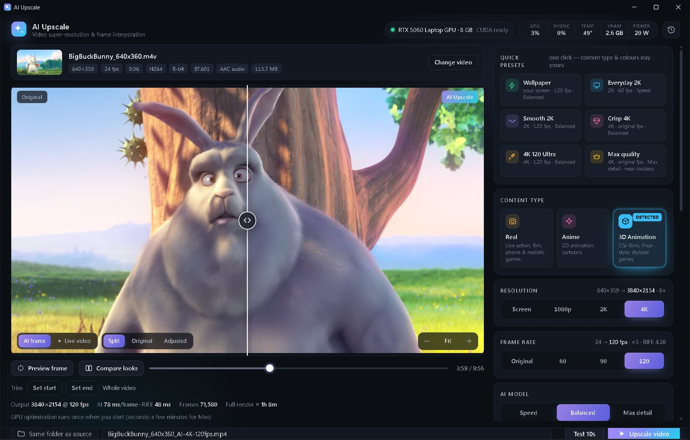

# AI Upscale — free AI video upscaler & 120 FPS enhancer for NVIDIA GPUs

**Website & download: https://repo-cdf.github.io/ai-upscale/**

Free, open-source AI video upscaler and enhancer for Windows. Upscale videos to **1080p, 2K or 4K**, make them smooth at
**60/90/120 FPS** with AI frame interpolation, and let it **automatically detect** whether your video is real footage, anime or
3D animation. Runs 100% locally on your NVIDIA RTX GPU — no sign-up, no watermark, no subscription, free forever.

## Features
- **Automatic content detection** (CLIP) — real / anime / 3D animation, picks the right AI models for you
- **AI upscaling** to 1080p, 2K, 4K or exactly your screen size (great for Wallpaper Engine)
- **Frame interpolation** to 60/90/120 FPS (RIFE 4.26) with scene-cut detection
- **Fake-HD detection** — finds the real detail level of stretched videos and upscales from there
- **Speed / Balanced / Max detail** tiers, accelerated with NVIDIA TensorRT and torch.compile
- **Live color grading**, noise reduction, debanding, sharpening, film grain
- Before/after viewer, Compare looks, 10-second test render, trim, quick presets
- 10-bit HEVC / AV1 / H.264 (NVENC), original audio kept

## Requirements
Windows 10/11 64-bit · NVIDIA GeForce RTX (20-series or newer, 6 GB+ VRAM) · NVIDIA driver 580+ · ~12 GB free disk during install

## Install
1. Download the zip from the [latest release](https://github.com/repo-cdf/ai-upscale/releases/latest) and extract it to a folder you own.
2. Run `Install.bat` (downloads Python, PyTorch/TensorRT and the AI models from their official sources, ~5 GB).
3. Open **AI Upscale** from your desktop.

## License & credits
AI Upscale is GPL-3.0. Models are downloaded from their authors and keep their own licenses (some are non-commercial) —
see `THIRD-PARTY-NOTICES.txt` in the download. Real-ESRGAN, APISR, AnimeJaNai, AniScale 2, LiveAction SPAN, Nomos2 MoSR,
CGIMaster, RIFE (via vs-rife), CLIP, spandrel, PyTorch, TensorRT, FFmpeg, uv. Demo images: Big Buck Bunny © Blender Foundation (CC BY 3.0).

Keywords: free ai upscaler, ai video upscaler, ai video enhancer, upscale video to 4k, anime upscaler, 120fps frame interpolation,
free Topaz Video AI alternative, Real-ESRGAN GUI, RIFE GUI, Wallpaper Engine upscale.
